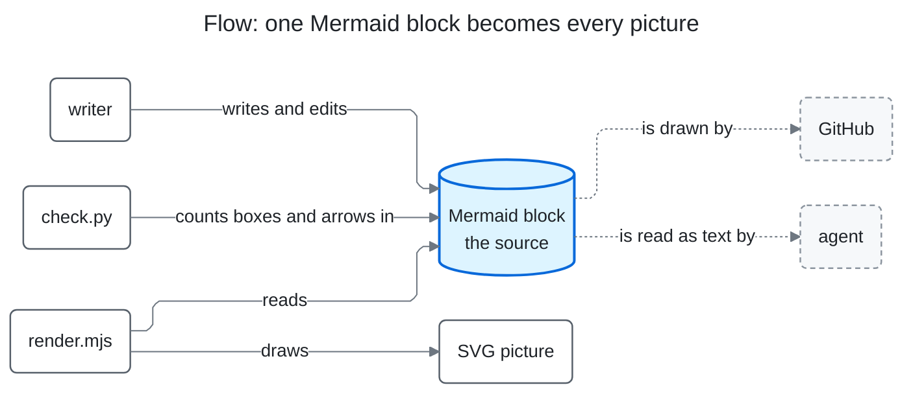

# Diagrams

Write each diagram once, as Mermaid text in the house style. People look at the picture drawn from that text, and agents read the text itself.

A diagram kept as an image is redrawn by hand every time the system changes, and an agent gets nothing from it but its alt text. A Mermaid block is cheap to write and to change, GitHub draws it, and one script turns the same block into an SVG where nothing draws it. So there is one thing to maintain, and no picture can drift from what agents read.

## Glossary

Use these terms exactly, in your planning and when you discuss the diagram with the user.

**Source**: the Mermaid block. It is the only thing you maintain.

**Picture**: anything drawn from the source: GitHub's drawing of the block, or an SVG file. A picture is never edited by hand and never delivered without its source.

**House style**: the header in [assets/house-theme.yaml](assets/house-theme.yaml) plus the three kinds of box. It replaces Mermaid's default look, which no diagram ships in.

**Kind of box**: a **part** of the system being described, a **store** where data rests, or an **external** system someone else runs. Each kind has one look, set out in [references/house-style.md](references/house-style.md).

**Title**: one sentence that states what the diagram shows, the finding and not the topic: "Parts: the three reminder processes meet only in the database", not "Reminder architecture". It opens with the diagram's type.

**Key**: one sentence under the diagram that says what a colour, a shape or a line style means. Write it whenever one of them carries meaning, and only then.

**Remove test**: take out a box, an arrow or a label. If the reader would not miss it, it stays out.

**Destination**: where the diagram will be read: GitHub Markdown, Confluence, a Claude artifact doc, a chat.

## The steps

1. **Question.** Write down the one question the diagram answers, then pick the type with [references/types.md](references/types.md). One diagram answers one question at one zoom level. What the parts are and how a request flows through them are two diagrams.

2. **Source.** Copy the header from [assets/house-theme.yaml](assets/house-theme.yaml) and write the title. Then write the boxes and arrows:
   - Name each box as the code names it, and give it its kind.
   - Label every arrow with a verb phrase that reads in the arrow's direction: "publishes order.created to". "Uses" says nothing.
   - Keep one direction of flow, and group boxes that belong together.
   - When the reader must follow the arrows in order, type the number into each label: "1. claims due jobs".
   - Draw arrows that stay inside the system solid, and arrows that leave it dashed.

3. **Check.** Run `python3 scripts/check.py <file>` on the `.mmd` file or on the Markdown file that holds the block. It reports arrows without a label, a missing title or header, and a flowchart with more than nine boxes or twelve arrows. Fix what it reports.

4. **Remove.** Apply the remove test to every box, arrow and label. A diagram still over nine boxes or twelve arrows is split: an overview, then one diagram per part that needs detail. Never shrink the text to make it fit. When the boxes fit but the arrows tell several stories, keep the one diagram and add a phase view for each story: the same block with that phase's arrows highlighted and the others greyed, as [references/house-style.md](references/house-style.md) shows.

5. **Render and look.** Run `node scripts/render.mjs <file>` to draw the SVG, then look at it. For a quick look at the structure, `node scripts/render.mjs <file> --ascii` prints a rough text drawing. Arrows that cross, labels that sit on each other and boxes far from their neighbours are fixed in the source: reorder the lines, regroup, or turn the flow. Never fix them in the picture.

6. **Place.** Follow [references/destinations.md](references/destinations.md) for the destination. Wherever it goes, the diagram carries its title, its key when it needs one, and its source beside every picture.

Finish with a short report: where the diagram is, how many boxes and arrows it has, what the check said, and whether you looked at a drawn picture, a text drawing or nothing. Say so plainly when no picture was rendered.

Blue is the source, grey boxes are readers outside the skill, and dashed arrows leave it. Everything a reader sees starts from the one block the writer edits.

## When the picture cannot be made

The render script needs Node and the `beautiful-mermaid` package, and it installs neither. When it says the package is missing, deliver the Mermaid block alone and say that no picture was rendered. Add a dependency to the user's project only when they ask for it.

The renderer draws flowcharts, state, sequence, class and entity-relationship diagrams, and XY charts. For any other type the Mermaid block is the deliverable, and a destination that cannot draw Mermaid gets a table or a list instead.

## With reader-first-docs

When the diagram sits in a doc written with the `reader-first-docs` skill, that skill decides whether the doc needs a figure and which shape it has; this one draws it. The sentence after the figure that says what to see in it stays that skill's takeaway, and exact values a reader will act on are repeated in the text.

## Reference files

- [references/house-style.md](references/house-style.md): the header, the three kinds of box, the two kinds of arrow, and what does not carry over to the SVG. Read it at step 2.
- [references/types.md](references/types.md): which diagram type fits which question, and which types the render script can draw. Read it at step 1.
- [references/destinations.md](references/destinations.md): what to deliver on GitHub, Confluence, a Claude artifact doc and in chat, and what is still unchecked there. Read it at step 6.
- [references/sources.md](references/sources.md): where each rule comes from, and which ones are still candidates. You don't need it to draw.
