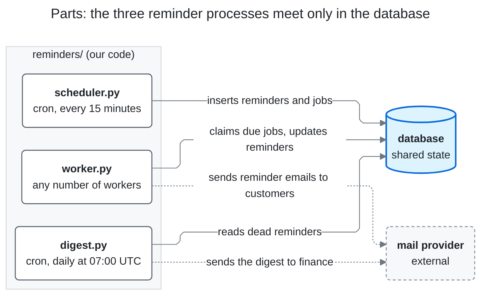

# House style

Every diagram has the same look, so a reader learns it once: white boxes, grey lines, one accent colour for data, and arrows that run at right angles. The look comes from a header copied into each diagram and from three kinds of box.

## The header

Copy [../assets/house-theme.yaml](../assets/house-theme.yaml) to the top of the Mermaid block and replace the title. Change nothing else in it.

| Line | What it does |
| --- | --- |
| `title` | The diagram's title. GitHub draws it above the picture. |
| `layout: elk` | Places boxes in layers and runs arrows at right angles with fewer crossings. A viewer without ELK is expected to draw the default layout instead. |
| `theme: base` and `themeVariables` | Replace Mermaid's default colours with the neutral base. |
| `flowchart` | Straight arrow segments and enough room between layers for arrow labels. |

Do not add a `fontFamily`. In our test Mermaid fell back to a serif face when it could not find the font.

## Three kinds of box

| Kind | What it is | Write it as | Look |
| --- | --- | --- | --- |
| part | A piece of the system being described | `id("label"):::part` | White, grey border, rounded |
| store | Where data rests: a database, a queue, a bucket, a cache | `id[("label")]:::store` | Blue cylinder |
| external | A system someone else runs | `id("label"):::external` | Grey fill, dashed border |

Put these three lines at the end of every flowchart:

```text
classDef part fill:#ffffff,stroke:#57606a,stroke-width:1.25px,color:#1f2328
classDef store fill:#ddf4ff,stroke:#0969da,stroke-width:2px,color:#1f2328
classDef external fill:#f6f8fa,stroke:#8c959f,stroke-width:1.25px,stroke-dasharray:4 3,color:#1f2328
```

A label has the name the code uses in bold, and at most one more line with the fact a reader needs:

```text
S("<b>scheduler.py</b><br>cron, every 15 minutes"):::part
```

Colour never carries meaning alone. A store is also a cylinder, and an external system also says so in its label or in the key.

The three classes are written for flowcharts. Sequence, state and other types take the header and nothing more.

## Two kinds of arrow

| Arrow | Write it as | Means |
| --- | --- | --- |
| Solid | `A -->\|stores orders in\| B` | Stays inside the system |
| Dashed | `A -.->\|charges the card through\| B` | Leaves the system, or enters it from outside |

Every arrow has a label: a verb phrase that reads in the arrow's direction.

## Numbered arrows and phase views

When order matters, type the number into the label: `W -->|1. claims due jobs| DB`. Number within one diagram, starting at 1.

A phase view shows one part of a flow without moving anything. Copy the whole block, give it a title that names the phase, and add two lines that grey the arrows outside the phase and highlight the ones in it:

```text
linkStyle 0,3,4 stroke:#d0d7de,color:#8c959f
linkStyle 1,2 stroke:#0969da,stroke-width:2px
```

The numbers count the arrows from 0 in the order the block writes them. Because every view has the same boxes and arrows, the layout engine places them the same way each time, so a reader can flip between views. The first block, with nothing greyed, stays the one diagram an agent needs; phase views are for people following the flow step by step.

## Groups

Put boxes that belong together in a group: `subgraph ours["reminders/ (our code)"]` up to `end`. Group by what the reader already knows, such as a repository, a deployable or a team.

Do not set a `direction` inside a group. In our test with the default layout it made arrows attach to the group's frame.

## The key

Mermaid draws no key, and a drawn one took a third of the picture in our test. Write the key as one sentence under the diagram:

> Blue is the database, the grey box is run by someone else, and dashed arrows leave our system.

Name only the kinds this diagram uses.

## What the SVG loses

The render script draws with `beautiful-mermaid`. Tested with version 1.1.3:

| In the source | In the SVG | What to do |
| --- | --- | --- |
| The header and its title | Removed; the title becomes the file's `<title>` | Write the title as the caption and the alt text |
| The dashed border of an external box | Drawn solid; the grey fill stays | Say "external" in the label or the key |
| Corner radius set in a class | Ignored | Use the rounded shape `( )`, as the table above does |
| The font | The reader's system font | Nothing |
| The grey label colour in a phase view | Labels keep their normal colour; the grey arrows stay grey | Nothing |
| `autonumber` in a sequence diagram | No numbers are drawn | Type the number into each message |
| `rect` in a sequence diagram | Drawn as a frame labelled with the colour | Leave `rect` out |
| `Note over` two participants in a sequence diagram | Dropped, or drawn over one participant | Draw one sequence diagram per phase and name the phase in its title |

## A whole diagram

````markdown


Blue is the database, the grey box is run by someone else, and dashed arrows leave our system.
````
