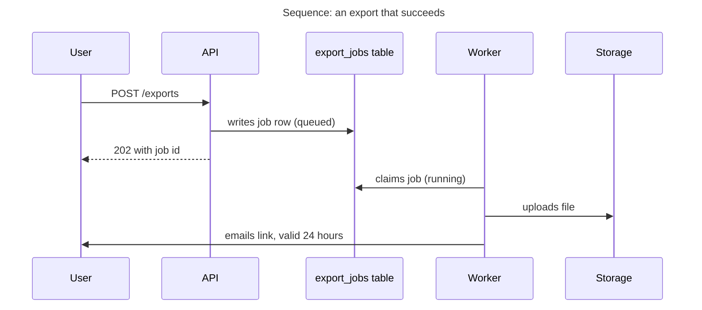

# Figures

Use a figure when the content has a shape, and prose when it is a reason. A reader rebuilds a shape told in sentences inside their head; a figure does that work once, for everyone.

## Which figure fits which shape

| The content is | Use | Not |
| --- | --- | --- |
| Steps in a fixed order | Numbered list | A paragraph with "then" |
| Steps that branch or loop | Flowchart | Nested bullets |
| Parties exchanging messages over time | Sequence diagram | A flowchart |
| Parts and how they connect | Architecture diagram at one zoom level | A list of components |
| States and what moves between them | State diagram | A table of statuses |
| Items compared on the same points | Table | Parallel paragraphs |
| Options judged against criteria | Table: options down, criteria across | Pros-and-cons bullets |
| Parent and child relationships | Indented list or directory tree | A diagram, unless links cross |
| The form of data | A schema or a sample record in a code block | A description of fields |
| How to call or run something | A minimal code sample that runs | A description of the call |
| Why, trade-offs, caveats | Prose | Any figure |

No shape, no figure. A diagram that answers none of the reader questions is decoration, and it costs both readers attention.

## Diagrams

When a skill for drawing diagrams is installed (`diagrams` in this skill set), use it to draw the diagram; the rules here are the minimum without it. Write diagrams as Mermaid in a fenced code block. Most Markdown renderers draw it for people, and an agent reads the source as a plain list of parts and connections. If the target can't render Mermaid, use a table or an indented list instead of an image.

Every diagram carries:

- **A title** that says its type and scope: "Sequence: a card payment that is declined".
- **One question.** If it shows both what the parts are and how a request flows, make it two diagrams.
- **One zoom level.** Systems and people, or the deployable parts inside one system, or the components inside one part. Never a mix.
- **A label on every arrow**: a verb phrase in the arrow's direction, such as "publishes order.created to". "Uses" says nothing.
- **The names the code uses.** One name per thing holds inside figures too.
- **Nine boxes and twelve arrows at most.** More than that, split by zoom level or by question.
- **A takeaway** in the sentence after it.

Then check it alone: could the reader understand the diagram with the prose around it hidden? If not, the labels are carrying too little.

````markdown


The API answers before any work is done; everything after the job row happens in the worker, so a stuck export is a worker problem.
````

The takeaway states the conclusion the reader should draw, and the one exact fact in the figure (24 hours) belongs in the text as well wherever a reader will act on it.

## Tables

- One row per item, one column per thing compared.
- Put units in the header, not in every cell.
- Sort by what the reader scans for.
- Seven columns at most. A table that needs more is two tables or a reference page.
- A column you can't fill for most rows should go.

## Code samples

- It runs as written. Test it, or say that you couldn't.
- It is the smallest sample that shows the point.
- It uses realistic names and values, the kind the reader will have. Not `foo` and `bar`.
- Every value the reader must replace is marked in capitals (`YOUR_API_KEY`), with a line saying where it comes from.
- Show what the reader should see after running it.

## Facts

Exact values go in the text, in a list or a table, where both readers can find and copy them. A figure may repeat a fact; it is never the only place a fact lives.

| Write | Not |
| --- | --- |
| "Retries stop after 5 attempts (`MAX_RETRIES` in `worker/config.py`)." | "Retries are limited." |
| "Run `make migrate` from the repository root." | "Run the migrations." |
| "Links expire after 24 hours." | A "24h" label on a diagram arrow and nowhere else |
